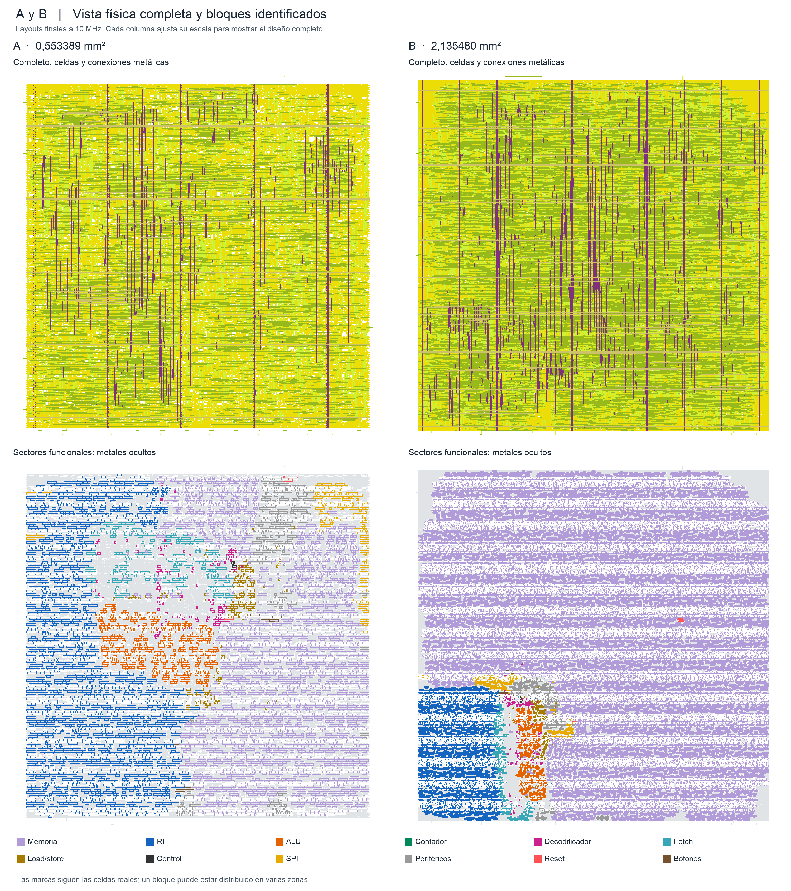

# Proyecto 3 — Espino ASIC / GF180MCU

Macro digital del juego de reflejos del Proyecto 2. Entrega y defensa: **4 de noviembre de 2026, 10:30**. Macro de celdas estándar con terminales lógicos; no incluye pads ni encapsulado.

## Documentación de entrega

[Entrega técnica](docs/Entrega_Tecnica.md) reúne arquitectura, resultados y la comparación visual 2×2. El [inventario de entrega](docs/Inventario_Entrega.md) identifica los documentos y artefactos preparados para publicación. El informe académico PDF se realiza por separado.

## Finales seleccionados

| Variante | Corrida | Memoria | Reloj / utilización inicial |
|---|---|---|---|
| A | stage13_final_traceable_a | ROM128 + RAM16 | 100 ns / 40 % |
| B | stage12_electrical_route_b | FF144 con carga desde ROM al iniciar | 100 ns / 40 % |

Ambas pasan setup/hold en nueve esquinas, capacidad, transición, fanout, DRC de ruteo, Magic DRC, LVS y antenas. Ambas conservan identificación de RF, ALU, contador y demás bloques funcionales. Selección verificable: [final_selection.json](config/gf180/final_selection.json).

| Resultado | A | B |
|---|---:|---:|
| Peor setup, ns | +46,597294 | +22,614665 |
| Peor hold/removal, ns | +0,130822 | +0,293077 |
| Área stdcell post-PNR, µm² | 284044 | 1166260 |
| Área die, mm² | 0,553389 | 2,135480 |
| Celdas secuenciales | 1329 | 5433 |

KLayout DRC se omite por falta de runset; no se afirma signoff IR/EM, equivalencia formal ni simulación SDF. Alcances: [Verificación](docs/Verificacion_Final.md) y [violaciones](docs/Violaciones_Finales_10MHz.md).

## Entorno e instalación

Mac Apple Silicon con Docker Desktop; contenedores Linux ARM64. LibreLane 3.0.17 y Yosys 0.62. PDK GF180MCU revisión 54435919abffb937387ec956209f9cf5fd2dfbee, variante gf180mcuD y biblioteca gf180mcu_fd_sc_mcu7t5v0. Imagen y versiones en [environment.lock.json](config/environment.lock.json). Python 3.13 e Icarus Verilog 13.0 se usaron para utilidades y simulación.

Instalar Docker Desktop para Apple Silicon y Python. Desde la raíz del repositorio:

~~~sh
python3 -m venv .venv
.venv/bin/python -m pip install ciel==2.6.1
docker pull ghcr.io/librelane/librelane@sha256:24640bd645ae992fa22d4a3e18fde10d728763c78fb140184f9975aa6c7d3e5e
env -u GITHUB_TOKEN -u GH_TOKEN .venv/bin/ciel fetch --pdk-root "$PWD/.pdk" --pdk-family gf180mcu 54435919abffb937387ec956209f9cf5fd2dfbee
env -u GITHUB_TOKEN -u GH_TOKEN .venv/bin/ciel enable --pdk-root "$PWD/.pdk" --pdk-family gf180mcu 54435919abffb937387ec956209f9cf5fd2dfbee
~~~

Para simulaciones locales, instalar Icarus Verilog; en macOS: brew install icarus-verilog. scripts/run_librelane.py usa la imagen fijada y monta el proyecto en /work sin red. No necesita Linux nativo ni una conexión GitHub de oficina.

## Reproducción final

Los checkpoints finales suman unos **19,7 MB comprimidos**. Restaurar y comprobar sus huellas sin ejecutar herramientas físicas:

~~~sh
.venv/bin/python -B scripts/replay_delivery_checkpoint.py --variant a --prepare-only
.venv/bin/python -B scripts/replay_delivery_checkpoint.py --variant b --prepare-only
~~~

Para repetir extracción, STA, exportación y comprobaciones desde las geometrías ruteadas, usar tags nuevos:

~~~sh
.venv/bin/python -B scripts/replay_delivery_checkpoint.py --variant a --tag entrega_a
.venv/bin/python -B scripts/replay_delivery_checkpoint.py --variant b --tag entrega_b
~~~

Se verificaron restauración, CRC y SHA. Restaurar no equivale a una nueva ejecución de signoff: los resultados medidos corresponden a las corridas originales. La cadena desde RTL y sus reparaciones físicas se documenta en [Reproducción final](docs/Reproduccion_Final.md).

## Programa y pruebas

~~~sh
.venv/bin/python -B scripts/generate_asic_memory.py
.venv/bin/python -B scripts/generate_asic_memory.py --check
~~~

El assembler y generador toman firmware/asic/game.s: **95 instrucciones**. A 10 MHz, tres segundos son 30.000.000 ciclos y una décima 1.000.000. Proyecto 2 se conserva en baseline/proyecto2; su Makefile por defecto programa la placa y no debe ejecutarse en este flujo.

Las netlists físicas A/B pasaron 21.295 muestras de comparación. La receta GF180 de cada variante pasó rondas correctas, error y reintento frente a RTL con estímulos idénticos y espera acortada. Esa prueba se distingue de la geometría de producción y de una simulación con retardos. Ver [pruebas](docs/Verificacion_Final.md).

## Documentación técnica

- [Requisitos](docs/Requisitos_Proyecto3.md).
- [Comparación, terminales, PDN y costo](docs/Comparacion_Final_AB.md).
- [Síntesis y bloques finales](docs/Sintesis_Final_Trazable.md).
- [Capturas](docs/Capturas_Layout.md).
- [Barridos: ocho puntos históricos, incluidos fallos](docs/Barridos_GF180.md).
- [Cambio RTL medido](docs/Ensayo_RTL_Trazabilidad.md).
- [Reparación eléctrica B](docs/Cierre_Electrico_B.md).

La carpeta entrega contiene el proyecto publicable. Las guías personales, cuadernos internos y archivos de trabajo se conservan fuera del repositorio. Informe PDF y preparación oral del equipo se realizan por separado.
