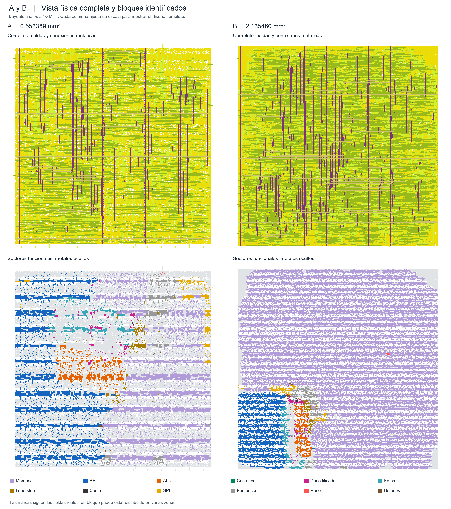

# Capturas de los finales seleccionados

Todas las regiones se cotejaron con los nombres y masters de la netlist y el ODB finales. Las imágenes son exportaciones de KLayout con anotaciones; no se modificó el GDS.

## Comparación de entrega en 2×2

A a la izquierda y B a la derecha. Arriba: celdas y ruteo; abajo: bloques funcionales coloreados con metales ocultos. Son layouts finales, con escala ajustada por columna. La memoria es violeta, RF azul, ALU naranja y contador verde en ambas columnas. [Manifiesto y fuentes](../evidence/layout_captures/entrega_2x2/manifest.json).

## A — stage13_final_traceable_a

[Vista general](../evidence/layout_captures/stage13_final_traceable_a_blocks/overview.png)

| Bloque | Celdas marcadas | Captura |
|---|---:|---|
| RF | 1804 | [Ver](../evidence/layout_captures/stage13_final_traceable_a_blocks/rf.png) |
| ALU | 589 | [Ver](../evidence/layout_captures/stage13_final_traceable_a_blocks/alu.png) |
| Memoria A: ROM y RAM | 2422 | [Ver](../evidence/layout_captures/stage13_final_traceable_a_blocks/memory.png) |
| ROM de instrucciones | 366 | [Ver](../evidence/layout_captures/stage13_final_traceable_a_blocks/instruction_rom.png) |
| ROM lectura de datos | 366 | [Ver](../evidence/layout_captures/stage13_final_traceable_a_blocks/data_rom.png) |
| Decodificador | 148 | [Ver](../evidence/layout_captures/stage13_final_traceable_a_blocks/decode.png) |
| Fetch | 249 | [Ver](../evidence/layout_captures/stage13_final_traceable_a_blocks/fetch.png) |
| Unidad load/store | 216 | [Ver](../evidence/layout_captures/stage13_final_traceable_a_blocks/load_store.png) |
| Control del procesador | 5 | [Ver](../evidence/layout_captures/stage13_final_traceable_a_blocks/control.png) |
| Perifericos MMIO | 321 | [Ver](../evidence/layout_captures/stage13_final_traceable_a_blocks/peripherals.png) |
| SPI | 166 | [Ver](../evidence/layout_captures/stage13_final_traceable_a_blocks/spi.png) |
| Reset | 4 | [Ver](../evidence/layout_captures/stage13_final_traceable_a_blocks/reset.png) |
| Sincronizacion de botones | 8 | [Ver](../evidence/layout_captures/stage13_final_traceable_a_blocks/buttons.png) |
| Contador: FF y logica de incremento | 110 | [Ver](../evidence/layout_captures/stage13_final_traceable_a_blocks/counter.png) |

Identidades y cajas: [regions.json](../evidence/layout_captures/stage13_final_traceable_a_blocks/regions.json). Todas las instancias: [all_instances.json](../evidence/layout_captures/stage13_final_traceable_a_blocks/all_instances.json). Huellas: [manifest](../evidence/layout_captures/stage13_final_traceable_a_blocks/capture_manifest.json).

## B — stage12_electrical_route_b

[Vista general](../evidence/layout_captures/stage12_electrical_route_b_blocks/overview.png)

| Bloque | Celdas marcadas | Captura |
|---|---:|---|
| RF | 1804 | [Ver](../evidence/layout_captures/stage12_electrical_route_b_blocks/rf.png) |
| ALU | 589 | [Ver](../evidence/layout_captures/stage12_electrical_route_b_blocks/alu.png) |
| Memoria B: FF y carga | 18942 | [Ver](../evidence/layout_captures/stage12_electrical_route_b_blocks/memory.png) |
| Decodificador | 148 | [Ver](../evidence/layout_captures/stage12_electrical_route_b_blocks/decode.png) |
| Fetch | 249 | [Ver](../evidence/layout_captures/stage12_electrical_route_b_blocks/fetch.png) |
| Unidad load/store | 216 | [Ver](../evidence/layout_captures/stage12_electrical_route_b_blocks/load_store.png) |
| Control del procesador | 5 | [Ver](../evidence/layout_captures/stage12_electrical_route_b_blocks/control.png) |
| Perifericos MMIO | 310 | [Ver](../evidence/layout_captures/stage12_electrical_route_b_blocks/peripherals.png) |
| SPI | 166 | [Ver](../evidence/layout_captures/stage12_electrical_route_b_blocks/spi.png) |
| Reset | 4 | [Ver](../evidence/layout_captures/stage12_electrical_route_b_blocks/reset.png) |
| Sincronizacion de botones | 8 | [Ver](../evidence/layout_captures/stage12_electrical_route_b_blocks/buttons.png) |
| Contador: FF y logica de incremento | 110 | [Ver](../evidence/layout_captures/stage12_electrical_route_b_blocks/counter.png) |

Identidades y cajas: [regions.json](../evidence/layout_captures/stage12_electrical_route_b_blocks/regions.json). Todas las instancias: [all_instances.json](../evidence/layout_captures/stage12_electrical_route_b_blocks/all_instances.json). Huellas: [manifest](../evidence/layout_captures/stage12_electrical_route_b_blocks/capture_manifest.json).

El contador incluye32FF y78celdas combinacionales de incremento,110en total. RF y ALU incluyen su lógica sintetizada. Los grupos padres e hijos se superponen: memoria incluye sus ROM, periféricos incluyen contador. No sumar áreas de esos grupos.

Las capturas anteriores y el ejemplo de antena se conservan en el historial y en evidence/layout_captures; no se presentan como estos finales.
