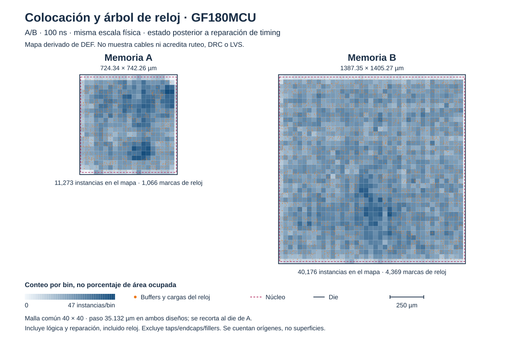

# Colocación, reloj y reparación temporal

29 de octubre de 2026. **A y B cumplen setup, hold, transición, capacidad y fanout en las nueve esquinas analizadas después de CTS**, a 100 ns y 40 % de ocupación inicial. Son resultados con parásitos estimados de colocación. El ruteo y las comprobaciones finales están en curso; no se declara todavía cierre extraído ni signoff. [Evidencias y huellas](../evidence/gf180_stage5/results.json).

## Resultados del candidato elegido

Las esquinas nom/min/max del RC producen los mismos valores en este análisis de colocación; se ejecutaron las nueve explícitamente. Tras ruteo se usarán SPEF extraídos para distinguir las condiciones de interconexión.

| Esquina de celdas | Setup A, ns | Hold A, ns | Setup B, ns | Hold B, ns |
|---|---:|---:|---:|---:|
| tt_025C_5v00 | 51,2343 | 0,346541 | 46,9972 | 0,344476 |
| ss_125C_4v50 | 7,57719 | 0,867308 | 0,0822666 | 0,911532 |
| ff_n40C_5v50 | 70,4017 | 0,119235 | 67,5955 | 0,103576 |

La tabla muestra peor slack, que puede ser positivo. **WNS y TNS de setup/hold son cero**, y los recuentos de violaciones slew/cap/fanout son cero, en cada una de las nueve esquinas. B tiene solo 0,0823 ns de margen de setup en la condición lenta; no extrapolar ese margen al ruteo ni calcular Fmax sin probar otros períodos.

| Magnitud después de reparación y CTS | A | B |
|---|---:|---:|
| Instancias, incluidos taps/endcaps | 14931 | 53200 |
| Área total de instancias, µm² | 403478 | 1499600 |
| Ocupación de núcleo medida | 80,0212 % | 79,5678 % |
| Buffers clasificados como reloj | 1049 | 4324 |
| Inversores clasificados como reloj | 17 | 45 |
| Buffers clasificados como reparación temporal | 3643 | 12946 |
| Buffers hold insertados en el último paso | 26 | 35 |
| Die conservado, mm² | 0,537649 | 1,949600 |

Los recuentos hold pertenecen al último paso y pueden estar incluidos en la categoría general de reparación: no sumarlos otra vez. La ocupación inicial del 40 % dimensiona el floorplan a partir de síntesis. Después se agregan infraestructura y buffers. El coste observado es más área de celdas dentro del mismo die; no hubo una compra ni ampliación del contenedor.



Cada color cuenta orígenes de instancias en cuadrados físicos iguales; no representa porcentaje de superficie ocupada. Los puntos naranjas identifican buffers/inversores conectados a redes CLOCK, incluidas sus cargas de balanceo. La figura excluye taps/endcaps/fillers y no muestra cables. Sus coordenadas y huellas están en placement.sources.json.

## Problemas observados y solución

El peor análisis previo a colocación era una recuperación del reset: en A, core_rst_ni tenía 747 cargas. Se repararon las redes después de colocar; se construyó el árbol de reloj y se añadieron retardos de hold. El SDC, el RTL y la ROM de producción permanecieron idénticos.

La primera pasada postCTS cerró setup/hold en todas las esquinas, pero conservó problemas eléctricos. A tenía una violación de capacidad y 92 de fanout; B tenía seis de slew, cuatro de capacidad y 373 de fanout. El peor slack de setup lento era 8,07562 ns en A y 0,225612 ns en B. Un flujo terminado no bastaba para dar por aprobada esa implementación.

Se ensayó clockv2 con grupos de cuatro cargas, capacidad de caracterización CTS de 0,16 pF y distancia de buffers de 100 µm. La medición típica eliminó las violaciones de capacidad; quedaron 32 ramas de reloj de fanout ocho en A y una red de datos de fanout ocho en B. No se ejecutó la matriz completa de esquinas para ese candidato intermedio; sus resultados se conservan como experimento.

Clockv3, candidato actual, mantiene grupos de cuatro y caracterización de 0,16 pF, reduce la distancia a 25 µm y repite la reparación sobre la colocación ya legalizada. Así se corrige también la red de datos de B. La explicación geométrica de por qué la primera pasada no la dividió es una hipótesis contrastada con coordenadas y código oficial actual; no se presenta como una demostración del algoritmo del binario fijado.

En B, la primera reparación de setup eliminaba fanout2298 y fanout3124. Dos puertas pequeñas pasaban a conducir directamente dos ramas y superaban 3 ns de transición: 4,377976 y 4,226103 ns. Se conservaron esos dos buffers durante la optimización con RSZ_DONT_TOUCH_LIST, permitiendo el resto de las reparaciones. La lista identifica instancias de esta síntesis concreta; si se resintetiza RTL, hay que revisar los nombres y su justificación.

Los parámetros CTS guían la construcción, pero no garantizan por sí solos las restricciones eléctricas. El criterio de aceptación son los informes medidos. [Documentación oficial de CTS](https://openroad.readthedocs.io/en/latest/main/src/cts/README.html).

## Rutas críticas actuales

Después de reparar, la ruta máxima lenta A parte de instr_rdata[12] y llega al dato de escritura de ram_ff[11][21]. En B parte de instr_rdata[5] y llega a mem_ff[63][18]. Atraviesan decodificación, selección de operación/dirección y distribución de controles de escritura. Ya no corresponde atribuir la peor ruta al reset inicial. La mejora RTL exigida por el enunciado sigue pendiente de implementación y comparación.

## Verificación funcional y procedencia

La prueba scripts/check_gf180_physical.py pasó tanto sobre la primera implementación como sobre clockv3. Usa las mismas fuentes y ROM de producción, modelos FUNCTIONAL oficiales GF180 y netlists sin pines de alimentación explícitos. No elimina ninguna celda física ni modifica los artefactos originales.

A/B comparan 21295 muestras por variante, dos arranques, dos comprobaciones dirigidas de reset asíncrono además del reset inicial, interrupción de carga, cuatro transferencias SPI y 178 cambios de botones. Los ciclos activos son 21266/20913 y los cambios de dirección de instrucciones 10633/10456. Se comparan todos los puertos y señales conservadas de reset, PC, contador, SPI e instrucciones; el JSON registra exactamente los bits disponibles tras síntesis.

Es una prueba acotada de producción, sin SDF ni equivalencia formal. No ejecuta una ronda completa de espera de treinta millones de ciclos ni sustituye los ensayos de interfaces RAM y juego acelerado de etapas anteriores. Las 38 huellas del Proyecto 2 original siguen coincidiendo; baseline, RTL, firmware y SDC no cambiaron.

## Reproducción

En una copia sin las corridas locales, reproducir primero el floorplan histórico según Mapeo_Floorplan.md. Después:

```sh
python3 scripts/run_gf180_stage5.py
for variant in a b; do
  python3 scripts/measure_gf180_corners.py --run config/gf180/runs/stage5_100ns_u40_cts_${variant}
done
python3 scripts/check_gf180_physical.py
python3 scripts/run_gf180_clock_repair.py
```

El último comando reproduce el experimento intermedio clockv2. Para el candidato clockv3, completar ambas continuaciones y mediciones antes de simular:

```sh
for variant in a b; do
  python3 scripts/resume_gf180.py --source-run config/gf180/runs/stage5_100ns_u40_cts_${variant} --source-step 08-openroad-detailedplacement --config config/gf180/${variant}_clockv3.json --tag stage5_100ns_u40_clockv3_${variant} --from OpenROAD.RepairDesignPostGPL --to OpenROAD.STAMidPNR-2
  python3 scripts/measure_gf180_corners.py --run config/gf180/runs/stage5_100ns_u40_clockv3_${variant} --step 07-openroad-stamidpnr-2
done
python3 scripts/check_gf180_physical.py --tag stage5_100ns_u40_clockv3 --state-step 07-openroad-stamidpnr-2
python3 scripts/summarize_gf180_stage5.py --final-tag stage5_100ns_u40_clockv3 --output build/reproduccion_stage5
python3 scripts/render_gf180_placement.py --tag stage5_100ns_u40_clockv3 --out build/reproduccion_stage5/placement.svg
```

Los lanzadores rechazan sobrescribir corridas. Si ya existen, elegir tags nuevos y propagarlos a origen, continuación, medición, simulación y resumen. El resumen exige además un directorio de salida nuevo: usar --output, sin sobrescribir evidence/gf180_stage5 conservado en Git. La figura se genera después del resumen, dentro de ese directorio. STAMidPNR mide por defecto una esquina; sus estados pueden arrastrar cifras antiguas de otras. El medidor independiente vacía las métricas heredadas y conserva únicamente las emitidas por cada análisis nuevo.

## Avisos y trabajo siguiente

Se conserva el aviso de bibliotecas Liberty cargadas repetidamente en pasos multiesquina, las dos redes flotantes reportadas por reparación y el ajuste automático de densidad de colocación A de 0,45 a 0,46. No se suprimieron. Las pruebas funcionales pasan; estos avisos no equivalen a tener DRC/LVS aprobados.

El ruteo usa configuraciones derivadas a_route.json y b_route.json, con reparación de diseño/timing después del ruteo global y verificadores explícitos de todas las esquinas. Los valores predeterminados del PDK solo hacían fatal setup típico y dejaban algunos errores eléctricos como avisos. Los nuevos verificadores endurecen la aceptación; el SDC y sus límites no se relajan.

Siguen extracción, análisis temporal final, DRC/LVS/antenas y revisión del layout. Después quedan barridos de tres períodos y tres utilizaciones, mejora RTL medida, área por módulo/contador e informe y defensa. La checklist principal permanece en 16/17.
