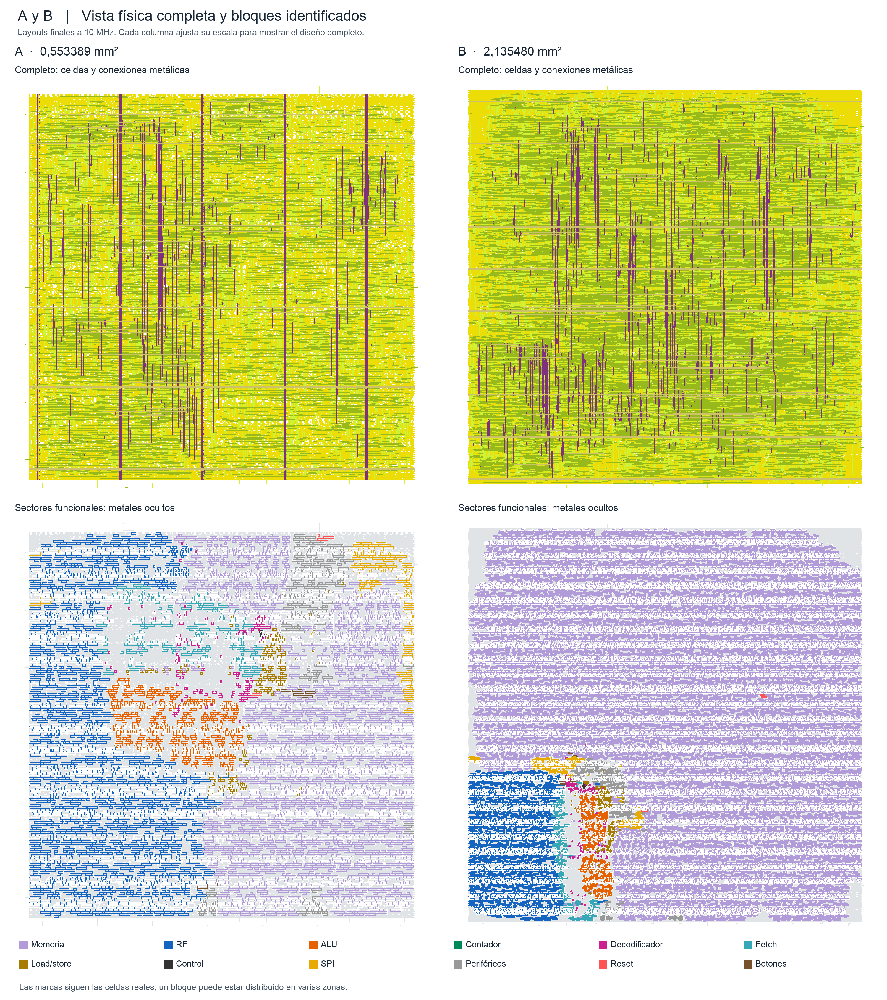

# Entrega técnica del Proyecto 3

El SoC del juego de reflejos se implementó como macro digital de celdas estándar GF180MCU en dos variantes de memoria. Ambas versiones finales cumplen a **10 MHz**, con utilización inicial de núcleo del **40 %**, los controles temporales, eléctricos y físicos ejecutados. El código, las pruebas, los resultados, las capturas y los checkpoints reproducibles forman la entrega técnica. El informe académico PDF se prepara por separado.

## Arquitectura y decisiones

La variante A combina ROM lógica de 128 palabras y RAM de 16 palabras. La variante B implementa una memoria unificada de 144 palabras mediante flip-flops, con carga inicial del programa desde ROM. El programa ocupa 95 instrucciones. El firmware de producción usa 30.000.000 ciclos para tres segundos y 1.000.000 para una décima a 10 MHz.

La adaptación sustituye las dependencias de FPGA y conserva el Proyecto 2 como referencia. Ambas versiones emplean síntesis con jerarquía identificable. La implementación final de A incorpora un retardo local de reset para resolver removal; B incorpora división de cargas y refuerzo de conductores. Las diferencias físicas finales incluyen estas reparaciones, además del efecto de las memorias.

## Resultados finales

| Magnitud | A | B |
|---|---:|---:|
| Período objetivo | 100 ns | 100 ns |
| Utilización inicial | 40 % | 40 % |
| Peor margen setup | +46,597294 ns | +22,614665 ns |
| Peor margen hold/removal | +0,130822 ns | +0,293077 ns |
| Área de celdas después de implementación | 284.044 µm² | 1.166.260 µm² |
| Área del die | 0,553389 mm² | 2,135480 mm² |
| Celdas secuenciales | 1.329 | 5.433 |
| Utilización física final | 54,598 % | 56,3497 % |

Setup, hold, capacidad, transición y fanout presentan cero violaciones en las nueve esquinas analizadas. También resultan cero DRC de ruteo, Magic DRC, discrepancias LVS y antenas. Se conservan los límites de biblioteca y fanout 10. Los márgenes positivos de la tabla son slack; WNS y TNS de violaciones son cero.

La selección exacta está en [final_selection.json](../config/gf180/final_selection.json). Los conteos y el alcance están en [Violaciones finales](Violaciones_Finales_10MHz.md), y su auditoría en [audit.json](../evidence/gf180_delivery/audit.json).

## Layouts y bloques identificados

La columna izquierda corresponde a A y la derecha a B. La fila superior muestra celdas y conexiones metálicas; la inferior oculta los metales y colorea las celdas de los bloques funcionales. Cada columna ajusta su escala para mostrar el diseño completo: el área de B es aproximadamente 3,86 veces la de A. Son vistas de los layouts finales, no del floorplan inicial antes de colocar celdas.

Los colores identifican memoria, RF, ALU, contador, decodificador, fetch, load/store, control, SPI, periféricos, reset y botones. Las marcas siguen las cajas de las celdas reales, cotejadas con ODB y netlist. Cada variante identifica 589 celdas de ALU, 1.804 de RF y 110 del contador, que incluyen 32 flip-flops y 78 celdas de incremento. El contador es parte de periféricos; las áreas de grupos padres e hijos no se suman.

El [catálogo de capturas](Capturas_Layout.md) permite inspeccionar cada bloque. Las huellas de la figura y sus fuentes se conservan en el [manifiesto](../evidence/layout_captures/entrega_2x2/manifest.json).

## Verificación y experimentos

Las netlists físicas finales de A y B pasaron 21.295 muestras de comparación con RTL por variante, incluyendo arranque, reset, botones y SPI. La receta de síntesis GF180 de cada variante también pasó dos rondas correctas y un error con reintento usando estímulos idénticos y espera reducida. Esta prueba de rondas se distingue de la prueba acotada sobre la netlist física de producción y no incluye retardos SDF. Véase [Verificación final](Verificacion_Final.md).

Se completaron ocho puntos de barrido: 100, 60 y 40 ns para ambas variantes al 40 %, y A a 100 ns con utilización del 30 y 50 %. Los fallos permanecen documentados. El menor die exitoso ensayado fue 0,445850 mm² al 50 %; los finales seleccionados mantienen el 40 %. Los barridos pertenecen a implementaciones anteriores y sus resultados no se transfieren automáticamente a los finales corregidos. No se afirma cierre a 25 MHz ni un máximo absoluto.

El [experimento RTL](Ensayo_RTL_Trazabilidad.md) mide una propuesta registrada: mejora setup con costo de área y conserva un exceso de fanout, por lo que no sustituye al final. Los datos completos están en [Barridos](Barridos_GF180.md), [Síntesis](Sintesis_Final_Trazable.md) y [Comparación física](Comparacion_Final_AB.md).

## Reproducción y alcance

El [README](../README.md) fija instalación, versiones y comandos. Los checkpoints finales comprimidos de A y B suman unos 19,7 MB. Su restauración, CRC y SHA fueron comprobados. La [receta de reproducción](Reproduccion_Final.md) distingue restaurar un estado ruteado, repetir verificaciones desde él y reconstruir desde RTL.

KLayout DRC está omitido por falta de runset. LVS usa la extracción DEF/LEF documentada. No se declara equivalencia formal EQY, simulación SDF ni signoff de caída IR o electromigración. El resultado es un macro académico sin pads ni encapsulado, aprobado en los controles ejecutados.

La [matriz de requisitos](Requisitos_Proyecto3.md) relaciona el enunciado con las evidencias. El informe PDF y la preparación oral del equipo completan la entrega académica; las guías personales de defensa y aprendizaje se entregan fuera de Git.
