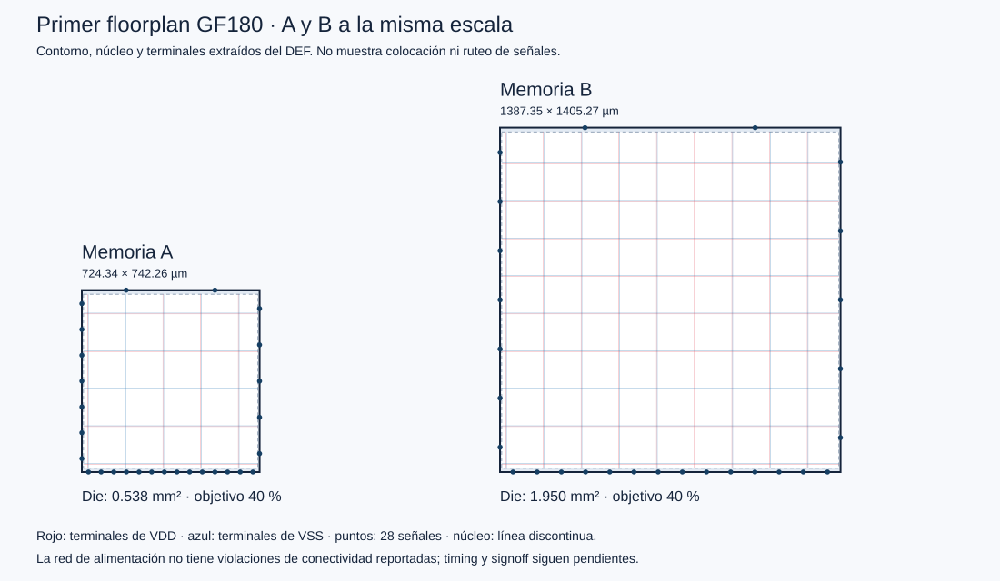

# Mapeo GF180 y primer floorplan

Estado histórico del primer floorplan; la continuación vigente está en [Colocación y timing](Colocacion_Timing.md).

29 de octubre de 2026. A y B completaron síntesis mapeada, dimensionamiento, filas, alimentación y terminales a **100 ns y 40 % de ocupación objetivo**. La prueba funcional con celdas GF180 también pasó en ambas variantes. **El diseño todavía no cierra timing y no tiene signoff físico.** [Resultados y huellas](../evidence/gf180_stage4/results.json).

## Configuración y alcance

Se utilizó LibreLane 3.0.17, imagen ARM64 fijada por digest, revisión GF180MCU 54435919abffb937387ec956209f9cf5fd2dfbee, variante gf180mcuD y biblioteca gf180mcu_fd_sc_mcu7t5v0. Las corridas de producción utilizan las 95 instrucciones a 10 MHz. SYNTH_PARAMETERS elige MemoryVariant=0 o 1; los demás módulos y restricciones son iguales.

El flujo se detuvo en Odb.CustomIOPlacement. GeneratePDN aparece antes de los terminales en esta versión; detenerse allí habría dejado incompleta su distribución. Aún no se ejecutan colocación de celdas lógicas, reparación después de colocación, árbol de reloj, ruteo, extracción final, DRC ni LVS. Los avisos de pasos omitidos reflejan este límite deliberado.

## Tamaños medidos

| Magnitud | A | B |
|---|---:|---:|
| Celdas lógicas tras síntesis | 6564 | 22861 |
| Área de celdas tras síntesis, µm² | 202151,5776 | 755052,2112 |
| Celdas secuenciales mapeadas | 1327 | 5433 |
| Die inicial, µm | 724,34 × 742,26 | 1387,35 × 1405,27 |
| Área de die inicial, mm² | 0,537649 | 1,949600 |
| Área de núcleo, µm² | 504213 | 1884690 |
| Área de instancias con taps y endcaps, µm² | 218212 | 812233 |
| Violaciones de conectividad de alimentación reportadas | 0 | 0 |

El área de síntesis suma celdas lógicas; el die añade espacio de colocación y márgenes. Los taps y endcaps se insertan después y elevan la ocupación medida sobre el objetivo inicial. No confundir esas tres áreas ni presentar este die como el mínimo enrutado. B exige más almacenamiento reescribible y multiplexores; la diferencia de área se mide con el mismo programa de producción.



La figura se genera desde los DEF reales, con núcleo y geometría de terminales VDD/VSS y señales. No muestra celdas lógicas colocadas ni interconexiones de señales. Reloj y reset están al norte; botones y entradas SPI al oeste; LED y MISO al este; displays al sur. Hay 28 terminales de señal y dos de alimentación. Son terminales del macro, no pads de encapsulado.

## Celdas dominantes

Todas pertenecen a gf180mcu_fd_sc_mcu7t5v0. Por cantidad: A tiene dffrnq_1 1323, nand2_1 1000, mux2_2 805, oai21_1 565 y aoi22_1 551. B tiene mux2_2 4686, dffq_1 4608, oai21_1 2163, oai22_1 1706 y nand2_1 1575. Los 4608 dffq de B corresponden al arreglo que se carga por escrituras, sin reset directo de cada bit. Falta completar atribución de área por módulo y fracción del contador para la sección 3.3.

## Restricciones iniciales

Solo clk_i es reloj secuencial. SPI se sobremuestrea con él; spi_sclk_i no se declaró como un segundo reloj interno. El SDC conserva checks internos y de recuperación del reset, sin excepciones false-path. Como presupuesto provisional de integración se fijan entradas/salidas máximas al 20 % del período (20 ns aquí) y mínimas a cero. No es una especificación medida de una placa. Se fija fanout objetivo 4 (más estricto que el valor 10 del PDK). Se heredan incertidumbre 0,25 ns, transición 0,15 ns, derating 5 % y carga de salida 72,91 fF. Antes de signoff habrá que revisar el contrato de las entradas asíncronas y el reset.

La alimentación utiliza los valores del PDK; la conectividad reportada no demuestra caída IR, electromigración ni DRC/LVS del macro completo. El lanzador limita cada contenedor a 4 CPU y 8 GiB, sin red ni descarga de imágenes; no cambia los recursos configurados en Docker Desktop.

## Problema temporal observado

Los números siguientes provienen de **STA previo a colocación**, heredado en el estado del floorplan; no de un análisis posterior al ruteo.

| Peor margen reportado en esquina lenta ss_125C_4v50 | A, ns | B, ns |
|---|---:|---:|
| WNS máximo, incluye recuperación | −58,7269 | −63,2206 |
| TNS máximo | −86125,5345 | −147205,5051 |
| WNS mínimo | −0,6939 | −0,6939 |
| TNS mínimo | −4,4679 | −4,4679 |

En A, la peor ruta documentada sale de _11632_/Q por core_rst_ni y llega a _10485_/RN, un check de recuperación del reset. El FF de liberación conduce 747 cargas, con transición calculada de 154,56 ns antes de reparación de red. No es evidencia de una ruta ALU crítica. Debemos colocar, reparar fanout/transiciones y volver a medir antes de decidir la mejora RTL exigida. Las otras esquinas también tienen violaciones de hold; la ausencia de error fatal al detener el flujo no equivale a timing aprobado.

Los informes de tres esquinas nominales están archivados. Antes de disponer de parasíticos de interconexión el flujo omite análisis duplicados min/max; esto no demuestra haber cerrado los nueve escenarios de la implementación final. No se deriva Fmax de esta corrida.

## Advertencias del RTL

Cada variante registró 13 avisos de Verilator y cero errores, latches o celdas sin mapear. Los logs conservan archivo y línea. Incluyen bits altos de datos MMIO no usados y bits bajos de direcciones ignorados, señales/constantes de desplazamientos heredadas que el subconjunto de ISA no implementa, illegal_insn sin tratamiento de trap y bits redundantes del SPI. No se suprimieron advertencias para hacer pasar la corrida. Los avisos de funciones no implementadas son límites del core heredado, no pruebas de compatibilidad con toda la ISA.

## Prueba funcional mapeada

Se sintetizaron dos imágenes de prueba separadas con perfil wait_only: espera 3000 y décima 1000000 ciclos. La ROM de producción se conserva. Icarus compiló los modelos oficiales locales de GF180 con FUNCTIONAL, sin SDF ni pines de potencia explícitos sobre la netlist pre-PDN.

Pasaron A (10623 ciclos) y B (10766), dos aciertos, un error individual, reintento y 600 comprobaciones con botones mantenidos. Se comparan todas las salidas por ciclo contra RTL. El segundo acierto cambia EE a 00 y permite observar su resultado a los mismos 302 ciclos desde el LED activo; el error aparece a los 269 ciclos. La escritura inicial 00 sobre 00 no se observa directamente en los terminales.

El mapeo elimina nombres internos de MMIO. Esta prueba no afirma comparar ese bus: conserva el comprobador semántico RTL y compara las salidas reales de ambas implementaciones. La comparación interna de MMIO permanece como evidencia de la etapa genérica anterior. No es equivalencia formal, simulación eléctrica ni una partida completa con esperas de treinta millones de ciclos. [Resultados mapeados](../evidence/gf180_stage4/mapped_game/results.json).

## Reproducción y trabajo siguiente

```sh
python3 scripts/run_gf180_stage4.py
python3 scripts/run_gf180_stage4.py --scope wait_only
python3 scripts/check_gf180_mapped_game.py
python3 scripts/summarize_gf180_stage4.py
```

El lanzador rechaza sobrescribir una corrida existente. Para repetir, elegir otro --tag y usar el mismo en el comprobador; el resumen de esta primera etapa conserva el tag stage4_100ns_u40. Los artefactos grandes permanecen bajo config/gf180/runs (excluidos de Git); se archivan logs, métricas, configuración, huellas y copias comprimidas de DEF/netlist. [Índice de evidencia](../evidence/gf180_stage4/results.json).

Sigue colocación y reparación de redes, después reloj y ruteo. Aún faltan los barridos de al menos tres períodos y tres ocupaciones/tamaños, mejora RTL medida, área por módulo, cierre temporal, DRC/LVS/antenas, layout final anotado e informe. La checklist continúa en 16/17: el último bloque agrupa ese trabajo físico y no representa un paso pequeño.
